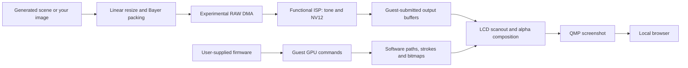

# Experimental machine and image pipeline

## Scope and layers

The machine targets one locally supplied Z7 C 3.80 MAIN fingerprint. Its CPU,
memory and peripheral behavior are an experimental contract sufficient for
selected firmware paths, not a complete EXPEED specification. The original
board header's "minimal research machine" wording reflects that history.

Firmware code, its fonts/icons and UI resources are read from the user's local
input at runtime. The emulator implements command semantics and buffer access;
it does not contain the original graphical assets. The browser displays the
QMP screenshot and adds no photographic scene or camera-status overlay.

## CPU and memory

The display machine uses two Cortex-A15 CPUs, a private A15 interrupt block,
an explicit GIC revision hypothesis, timers and inferred RAM windows. MAIN is
mapped at `0x10020000`, with explicit PC selection for both CPUs. Boot SRAM is
at `0x04008000`; application RAM begins at `0xa1800000`. Additional workspaces
and image pools cover allocations exercised by the selected firmware paths.

The guest creates its own runtime MMU mappings. Physical/virtual addresses,
aliases and GPU buffer handles must not be conflated. Some large pool backing
is a functional capacity assumption, not a measured physical camera DRAM map.
Unknown accesses are diagnostic; returning plausible values everywhere would
hide missing device behavior.

## Assisted startup

The host pauses the guest at version-specific checkpoints and calls original
memory, power, system-state and application-ready routines. A synthetic system
report and a logged power transition stand in for missing controller behavior.
The shooting profile adds fixed orientation, disables the idle timeout and
chooses diagnostic calibration branches.

For stationary live view it additionally disables the unmodeled MVD schedule
in guest RAM before capture allocation. The expected RAM state is checked by
SHA-256, rather than shipping its table bytes. A two-byte resource-version
fixture supplies a version expected by the selected code path; it is not a
sensor calibration dataset. These actions are recorded in local session logs.

Original program bytes in the input file are unchanged. Guest RAM is changed,
and original functions are deliberately invoked. Thus the result is **assisted
system emulation**, not passive observation or proof of natural camera power-on.

## RAW and functional ISP

The active functional input is2780×932, RGGB, 12-bit levels in little-endian u16,
stride5568, black64 and white4095. An earlier ingress experiment uses1380×918
packed12, stride2080;640×480 is a generic input-boundary test. These are explicit
emulator layouts, not claims that a physical Z7 CMOS outputs those dimensions.

The model writes samples through observed DMA descriptors. The ISP validates
the supported configuration and destinations before writing the guest's output
buffers. It performs simple RGGB-cell reconstruction, an sRGB tone response,
integer resampling and limited-range BT.601-like NV12 conversion. It implements
none of Nikon's proprietary denoise, calibration, color science or AF algorithms.

An input-byte cache includes RAW row padding in its identity. Changing any byte
invalidates all cached geometries. Output geometry/stride is part of each cache
entry. Destination addresses are not: identical content can be copied to a new
guest-selected buffer. Three output channels are functional hypotheses.

## Interrupts and restart

In the supported transaction, IRQ99 status at`0x20380024` distinguishes RAW
input completion(bit1) from MIPU processing completion(bit12). IRQ102 status
at`0x20100020` distinguishes command-bank completion. Completion is emitted
after actual output writes, with enabled banks respected.

RAW shutdown is a separate transaction. Four drain requests must arrive before
an asynchronous completion mask`0x014a0000` is raised. That event creates no
new frames and still completes after TG stops. A partial request is incomplete;
repeated polling does not produce duplicate completion. A new TG start resets
stream-specific latches and boundary phase, retaining lifetime observation counts.

This distinction matters for MENU: image display alone does not release the
guest's capture-stop wait. An uncompleted drain can leave the next live-view
configuration queued and produce a black return or stale-frame access.

## GPU and LCD

`nikon-z7-gpu.h` implements a selected SMAPH-F/OpenVG-style command subset:
path decoding, transforms, fill/stroke, bitmap sampling, alpha and supported
packed/planar output formats. Stroke geometry is constructed before transforms,
so nonuniform scaling affects its width. Unsupported state remains diagnostic.

Fill color register185 is little-endian RGBA; for example`0xff4848f0` represents
RGB240,72,72. Reading it as reversed byte order changes red into blue. Outlined
text/icons require both a black stroke/bitmap layer and correct source-over
handling of transparent areas in the white fill. A host recoloring/outline would
not repair the underlying renderer.

LCD scanout reads the guest's selected Y/UV buffers and composes its UI layer.
It is separate from the older renderer surface probe. Valid DMA, valid ISP output,
native selection of that output, LCD read and visible screenshot are separate
observations; one is not sufficient evidence for the next.

## Upstream QEMU adjustments

The integration script changes only these three upstream files beyond machine
registration and the overlay itself:

| File | Adjustment |
| --- | --- |
| `hw/intc/arm_gic.c` | CPU-less diagnostic reads use bank0 instead of dereferencing null `current_cpu`; guest core selection is unchanged |
| `target/arm/helper.c` | CPSR hflags are rebuilt on actual relevant M/E/IL transitions |
| `target/arm/tcg/op_helper.c` | Removes duplicate hflags rebuild; optional shadow recomputation checks agreement |

Set `Z7_VERIFY_CPSR_HFLAGS=1` before launching to enable the shadow check. It
recomputes the original flags and asserts that the cached result agrees. These
changes are version-pinned and not claimed to be upstream-approved.

## Persistence

The machine has no complete VMState/migration implementation. Browser pause
holds a live process; it does not save a portable snapshot. Recovery is a cold
restart from source, manifest and local inputs. Never describe a screenshot,
source archive or paused process as a complete saved camera state.
